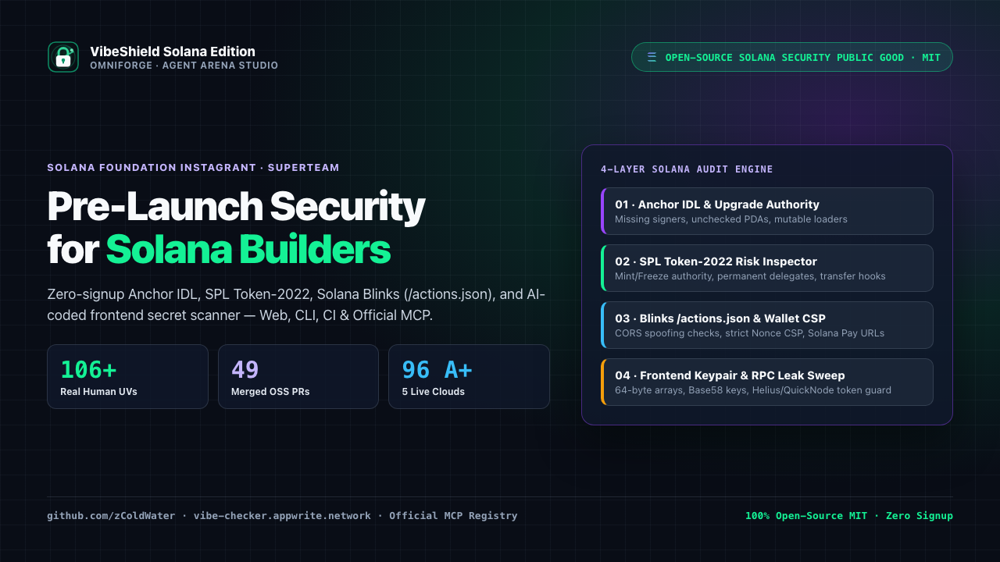

# VibeShield Solana Edition (`vibeshield-solana`)



**Zero-dependency Solana Mainnet pre-launch security scanner** for **SPL Token-2022 extensions**, **BPF Upgradeable Program authorities**, **Solana Actions & Blinks (`actions.json`)**, and **x402 Solana Pay treasury ATA readiness**.

- **Live Zero-Install Browser Scanner**: <https://zcoldwater.github.io/vibeshield-solana/>
- **Companion Web Security Scanner**: <https://vibe-checker.appwrite.network>
- **Official MCP Registry Integration**: `io.github.zColdWater/mcp-launch-audit` (<https://github.com/zColdWater/mcp-launch-audit>)
- **License**: MIT (100% Open-Source Solana Public Good)

---

## Why Solana Needs Dedicated Pre-Launch Guardrails

Generic Web2 and EVM scanners cannot see Solana's unique account model and protocol extensions:

1. **SPL Token-2022 (`TokenzQdBNbLqP5VEhdkAS6EPFLC1PHnBqCXEpPxuEb`) Extension Risks**:
   - **`PermanentDelegate`**: Allows unconditional transfer or burning of tokens from *any* holder's Associated Token Account without owner signature.
   - **`TransferHook`**: Executes arbitrary external CPI code on every transfer; an upgradeable hook can freeze AMM/vault withdrawals.
   - **`TransferFeeConfig` & `DefaultAccountState = Frozen`**: Breaks protocols assuming `1:1` received balances or unfrozen new ATAs.
2. **BPF Upgradeable Loader (`BPFLoaderUpgradeab1e`) Governance**:
   - Reads the exact **45-byte `ProgramData` binary header** via `dataSlice` (`<60ms` without downloading megabytes of ELF bytecode) to verify `lastDeployedSlot`, immutability, and whether `upgradeAuthority` is an EOA vs. Squads v3/v4 / SPL Governance PDA.
3. **Solana Actions & Blinks (`/actions.json`) Compliance**:
   - Verifies HTTPS enforcement, `Access-Control-Allow-Origin: *` wildcard CORS headers required by wallet Blink unfurlers (Phantom, Backpack, Dialect), and open-proxy wildcard rules.
4. **x402 & Solana Pay Treasury Readiness**:
   - Detects HTTP `402 Payment Required` Solana payment challenges and checks on-chain whether the treasury's **Mainnet USDC (`EPjFWdd...`) Associated Token Account** is initialized and rent-exempt so buyer settlements never revert with `AccountNotInitialized`.

---

## Quick Start (Zero Dependencies, Node >= 18)

```bash
# Scan PayPal USD (SPL Token-2022 mint with PermanentDelegate & ConfidentialTransfer)
node bin/vibeshield-solana.mjs 2b1kV6DkPAnxd5ixfnxCpjxmKwqjjaYmCZfHsFu24GXo

# Scan Jupiter v6 Aggregator BPF Upgradeable Program (45-byte ProgramData header decode)
node bin/vibeshield-solana.mjs JUP6LkbZbjS1jKKwapdHNy74zcZ3tLUZoi5QNyVTaV4

# Scan Circle Mainnet USDC SPL Mint
node bin/vibeshield-solana.mjs EPjFWdd5AufqSSqeM2qN1xzybapC8G4wEGGkZwyTDt1v

# Output machine-readable JSON for CI/CD or AI Coding Agents (Cursor / Claude Code / Codex)
node bin/vibeshield-solana.mjs 2b1kV6DkPAnxd5ixfnxCpjxmKwqjjaYmCZfHsFu24GXo --json
```

## Programmatic Usage

```js
import { scanTarget } from "vibeshield-solana";

const report = await scanTarget("2b1kV6DkPAnxd5ixfnxCpjxmKwqjjaYmCZfHsFu24GXo");
console.log(report.score, report.grade, report.findings);
```

## Run Tests

```bash
npm test
```
